# AGRO AI Assistant

<p align="center">
  <a href="https://github.com/Amatya27/AGRO_AI_Assistant/actions/workflows/tests.yml"></a>
</p>

<p align="center">
  
</p>

AGRO is a voice assistant I built during my AI internship at Cloud Counselage (Dec 2020 to Jan 2021). You talk to it and it answers out loud: it looks things up on Wikipedia, searches the web, opens the internship's training tasks and resources, tells the time, plays music and opens VS Code.

[Watch the original demo on YouTube](https://www.youtube.com/watch?v=sU0c1Tfny_Q). The follow-up with a live translator is [A.G.R.O 2.0](https://github.com/Amatya27/A.G.R.O_2.0).

## What you can say

| Say something with... | AGRO will |
|---|---|
| "wikipedia ..." | read a two-sentence Wikipedia summary |
| "search ...", "updates on ..." | open the top 3 web results |
| "open youtube", "open google" | open the site |
| "linkedin", "cloud counselage", "contact", "email" | open the company's pages or a new email |
| "week 1" to "week 4", "drl" | open that week's training task or the Digital Resource Library |
| "who is your developer" | introduce me and open my LinkedIn |
| "play music" / "song" | play a random song from your music folder |
| "the time" | tell you the time |
| "open code" | start VS Code |
| "exit", "shut down" | say goodbye and stop |

## How it works

```
microphone -> Google speech-to-text -> keyword rules -> action -> pyttsx3 speaks the answer
```

`agro/intents.py` holds the keyword rules in the same order as my original if/elif chain, so the first match wins exactly as before. Each rule maps to a small function in `agro/actions.py`, and all links and paths live in `agro/config.py`.

## Running it

```bash
pip install -r requirements.txt
python -m agro          # talk to it
python -m agro --text   # type instead, no mic needed
```

Optional settings: `AGRO_MUSIC_DIR` (defaults to `~/Music`), `AGRO_VSCODE` (path to VS Code) and `AGRO_LANGUAGE` (speech language, default `en-in`).

```bash
pytest   # 28 tests, no mic or internet needed
```

## Rebuilt in 2026

The original was one script that only ran on my Windows laptop (hard-coded Chrome path, `D:\Songs`, the Windows-only `sapi5` voice). I rebuilt it so it's easier to read, run and test, and kept every command:

- split into a small package: config, speech, intent rules and actions
- uses the default browser and a configurable music folder, and works on Windows, macOS and Linux
- `--text` mode, so it can be tried without a microphone
- handles a missing Wikipedia page or search library instead of crashing
- fixed the email link (`mailto://` became `mailto:`)
- unit tests for every command and the rule order
